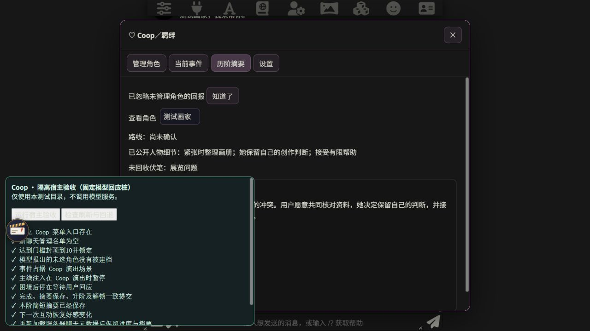

# Coop 审核修复验证（2026-10-26）

基于 `99146c6` 复核审核报告，修复保存后的状态重算、重设的已演出内容保护、新操作的依赖粒度及连续回答／路线冲突处理。自动化测试共 **157 项通过，0 项失败**，另通过语法及空白检查。逐项判断、兼容策略和验证边界见 [审核复核与修复](coop-review.md)。以下版本记录保留为历史证据。

# Coop 0.39.4 上下文验证

自动化测试共 **105 项通过，0 项失败**。新增覆盖：无补充设定注册 NPC、读取其所在整合卡及世界书／对话、群聊仅取成员背景、明确目标卡优先、补充与自动资料分开、截断保留最新剧情、新卡补充栏默认空白。以下版本记录留作历史证据。

# Coop 0.39.3 别名验证

自动化测试共 **99 项通过，0 项失败**。新增覆盖：别名解析与去重、称呼规范化、全名与简称归属、英文词边界、已知中文长名字防误认、重复称呼拒绝、旧档兼容、别名修改后原分数与锁保留，以及实际宿主适配器的可参与判断。以下各版本记录留作历史证据。

# Coop 0.39.1 验收更新

固定四阶门槛为 **30、60、90、100**，Rank 上限 4，Rank 3 确认关系。`npm test` 当前为 **76 项通过、0 项失败**，包括四阶完整推进、固定门槛不可修改、Rank 3 双路线、空旧档升级、旧进度防误重算、单聊及群聊候选读取边界。

角色下拉框显示当前角色卡／群聊成员，已加入项标为「已管理」并禁止重复添加；不会从整合卡正文自动创建 NPC。以下保留 0.39.0 的初始宿主验收记录，其中十阶和旧门槛描述只代表当时版本。

# Coop 0.39.0 初始验收留档

验证日期：2026-10-25。开发基线：`35b9877a1102efca098609035f09a202187b9a75`（0.38.8）。

## 已完成的验证

在 Node.js 24.18.0 下运行 `npm test`，共 **68 项通过，0 项失败**。测试不需要模型连接或密钥，覆盖以下行为：

| 范围 | 主要验证内容 |
|---|---|
| 名单与计分 | 新聊天名单为空；未选角色不建档；三种管理模式；重复互动只结算一次；非法、越界及无原文依据的分数不采用 |
| 门槛硬锁 | 越过门槛时封顶、丢弃溢出；就绪及事件期间同时阻断加分与扣分；暂停、移出及重新启用不解除锁；锁定期间的迟到报告不会在解锁后补分 |
| 事件状态机 | 三轮及两轮结构；真实用户回应断点；群聊同一用户消息不重复推进；同一门槛不能创建两个未完成事件；Rank 9 的明确路线确认；十阶完整流程 |
| 连续性 | 全部历阶摘要按顺序注入；既有故事种子不能被替换；摘要修正使旧计划暂停；世界事实变更核对前值；历史超过预算时明确报错，不静默丢弃早期 Rank |
| 完成与恢复 | 完成、摘要、Rank 和解锁一次提交；无实际收束证据保持未完成；人物成长字段不可缺；可用已确认字段整理摘要；只核对已有正文来补齐归档，拒绝把未完成正文补成完成 |
| 消息版本 | 编辑、删除、重生成、切换回复后的有效来源重放；相关 Rank、分数、锁、路线及后续依赖随来源失效而撤销；日志保存来源引用，避免复制整段聊天 |
| 持久化 | 30 个聊天档案独立保存；HTTP 保存失败、服务器业务错误及重试；失败不发布成功升阶；聊天切换与异步请求串台防护；未知未来 schema 不覆盖 |
| 生成及并发 | 角色被停用、场景变化及版本变化时拒绝旧生成结果；同浏览器一个 Coop 写入方；写入权交接；并发聊天加载；旧任务不能清除新任务的生成闸门 |
| 宿主与变量 | Coop 演出时阻止旧主线进度写入；演出外原主线写入仍可使用；Coop 程序字段受保护；正文与额外变量模型回报解析；早到的额外回报只处理一次；JSON 原型污染拒绝 |

另外对修改后的 JavaScript 执行语法检查，并使用 `git diff --check` 检查提交内容的空白错误。

## 隔离的真实宿主验证

使用本机 **SillyTavern 1.19.0** 的代码和依赖创建独立测试实例，监听 `127.0.0.1:8019`，数据目录与日常使用目录分离。测试只使用虚构角色、默认示例角色及固定的模型回复桩，未调用付费模型服务。测试桩只存在于隔离测试目录，不随扩展源码发布。

通过真实浏览器界面、宿主事件和聊天保存 HTTP 接口确认了：

1. 扩展菜单中有独立的「Coop／羁绊」入口，打开角色、事件、摘要、设置四个页签。
2. 新聊天名单为空；原生「加入所选角色」按钮能够手动加入当前角色，并启用仅维护好感模式。
3. 分数达到 10 时立即封顶、锁定；回报中附带的未选 NPC 不会被创建。
4. Coop 演出接管场景，主线注入为空；困境阶段停下来等待用户回应。
5. 根据实际用户回复完成 Rank 1，将摘要、人物变化、升阶与解锁一致保存；下一次互动可以继续从 10 增至 12。
6. 从真实聊天元数据重新加载后保留摘要及 Rank。浏览器刷新并重新打开该聊天后，进度仍然存在。
7. 编辑作为事件完成依据的旧消息后，完成记录失效：退回 Rank 0、恢复该门槛锁，并移除不再成立的摘要。

## 尚需真实使用确认的边界

- 固定模型回复验证的是程序交互、状态及持久化，不代表真实模型已经通过叙事质量验收。不同模型对角色声音、伏笔深化和互动节奏的表现，仍需实际游玩确认。
- 外部 MVU 任意角色字段的强制好感绑定未开放。当前使用 Coop 自有分数；正文和额外变量模型都通过专用回报提交建议。具体角色卡的严格 schema、变量模型和其他扩展组合仍需单独适配。
- 本次浏览器验收覆盖基础完整流程；两轮、十阶、Rank 9 双路线、保存失败和竞争条件主要通过自动化测试验证，不能视为这些情况都已在真实模型会话中逐一游玩。
- 同浏览器通过 Web Locks 限制为一个写入方；跨设备对同一聊天同时操作，仍要求保持单活跃会话。浏览器缺少 Web Locks 时保持只读。
- 全部历史的提示词存在显式容量上限。超过上限会要求压缩摘要或修正档案，不能保证任意长度的历史都能塞入任何模型窗口。
- 当前产物是本地开发分支，未向 GitHub 推送，也未替换日常运行的酒馆扩展。安装及真实模型连接后的回归需另行执行。
